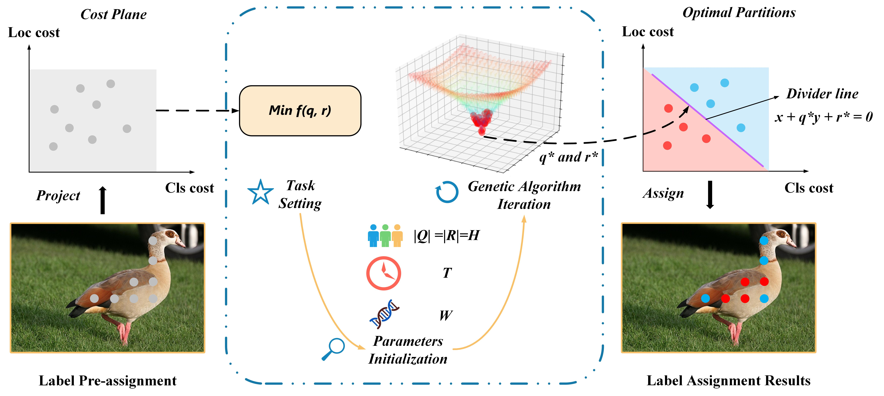

# OPA 论文代码库

基于 **mmdetection 2.25.1** 代码库，主线为 **paper3 OPA**（GA 检测器 / GAHead：GMM 正样本分配 + paa_reassign 重分配 + IoU/GIoU 分支 + score_voting），同时归档两条旧实验线（paper_sd 蒸馏、paper_ssl MAE 预训练 ViT）。

## Paper

**Optimal Partition Assignment for Universal Object Detection**（IEEE Transactions on Multimedia, 2022）

Link: https://ieeexplore.ieee.org/document/9956875



## 目录结构

```
OPA/
├── a_configs/              自定义配置 194 个（详见 a_configs/README.md）
│   ├── paper3_OPA/         103  coco 65 + voc 38   主线：GA/OPA + 对比方法
│   ├── paper_sd/           79   dior 41 / nwpu 23 / dota 11 / voc 4   蒸馏（废弃）
│   └── paper_ssl/          12   dior 8 / nwpu 4   MAE-ViT / Swin 自监督预训练
├── configs/                mmdet 官方配置（未改动，作 _base_ 上游参考）
├── mmdet/                  官方框架 + 自定义模块（见 §3）
│   └── yyr_creation/       自写工具包：逐类 mAP 的 pycocotools、多色可视化
├── DOTA_devkit/            DOTA 官方 devkit + 裁剪/格式转换脚本（见 §7）
├── tools/                  官方工具 + parse_result.py / parse_result_test.py / d_t.sh
├── yyr_tools/              草稿脚本（fun1/2/3.py、test.sh，路径已失效）
├── demo/ docker/ docs/ tests/ resources/   官方附带内容
├── README_base.md          官方英文 README（原 README.md）
├── README_zh-CN.md         官方中文 README
└── 代码说明 / 基本说明 / 说明dota   2.12 时代旧文档（历史参考，命令已过时）
```

## 自定义代码总览（mmdet/）

### Part 1 · detectors（5 个自定义检测器）

| 检测器（文件）                 | 基类                | 实现的能力                                                                                                                               | 状态         |
| ------------------------------ | ------------------- | ---------------------------------------------------------------------------------------------------------------------------------------- | ------------ |
| GA (ga.py)                     | PAA                 | OPA 主检测器：训练流程即标准 PAA，论文核心分区分配逻辑全部在 GAHead；另覆写 show_result（score_thr=0.7 硬编码、蓝色框）                  | 在用（主线） |
| VIT_ATSS (vit_atss.py)         | SingleStageDetector | ViT/Swin + ATSS 的封装：pretrained 转发给 backbone、neck 可选（单尺度特征直连）；附 FPN 热力图可视化工具（未启用）                       | paper_ssl    |
| SS (ss.py)                     | PAA                 | 自蒸馏：4 条监督通路（GMM 特征增强 / 跨层分类监督 / 正样本分类 / 正样本回归 NIoU），epoch>3 延迟启动，开关硬编码、当前仅回归通路生效     | 废弃归档     |
| Distill_PAA (dis_paa.py)       | PAA                 | 师生蒸馏：冻结教师 + 1×1 通道适应层 + 关系蒸馏（正样本分类特征成对距离 smooth-L1，仅蒸馏教师更优样本集）；几何蒸馏 dis_geo 为未完成残段 | 废弃归档     |
| Prune_Retina (prune_retina.py) | RetinaNet           | BN-γ 网络瘦身剪枝实验（全局阈值 50%）；剪枝调用与结构重建代码均已注释，当前等效普通 RetinaNet                                           | 孤儿         |

另有 a_yyr_tools.py（12 行小工具，孤儿，无配置引用）。

### Part 2 · dense_heads（11 个自定义 head）

| Head（文件）                              | 系列        | 实现的能力                                                                                                                                                                                                     | 配置引用   |
| ----------------------------------------- | ----------- | -------------------------------------------------------------------------------------------------------------------------------------------------------------------------------------------------------------- | ---------- |
| GAHead (ga_head.py)                       | GA/OPA      | **OPA 核心**：ATSS 初分配后，用 geatpy 进化算法在 (分类损失, 回归损失) 二维空间拟合最优分区直线重划正负样本（ga_reassign，替代 PAA 的 GMM 阈值）；IoU 预测分支（GIoU 目标）+ score_voting；topk=9 硬编码 | 10（主线） |
| GAHead2 (ga_head2.py)                     | GA/OPA      | GAHead 实验变体：topk=18 且可配置；EA 目标函数张量化上 GPU，种群 150 / 迭代 100                                                                                                                                | 0          |
| GAHead3 (ga_head3.py)                     | GA/OPA      | GAHead 简化变体：弃用进化算法，按损失空间到原点距离的中位数分区                                                                                                                                                | 0          |
| GAHead_ASSIGN (ga_head_vis_assign.py)     | GA/OPA      | GAHead + vis_assign 分配过程可视化钩子                                                                                                                                                                         | 0          |
| SSHead (ss_head.py)                       | 蒸馏        | PAA GMM 重分配 + IoU 分支 + score_voting；另提供 loss_fea / loss_tea 导出正样本特征与损失，供 SS、Distill_PAA 蒸馏使用                                                                                         | 4          |
| SS_BAYHead (ss_head_bayesian.py)          | 蒸馏        | SSHead 的贝叶斯变体：paa_reassign 中 GMM 换为 BayesianGaussianMixture；移除 loss_fea                                                                                                                           | 3          |
| SSHead2 (ss_head2.py)                     | 蒸馏        | 在 AnchorHead 上重建的 ATSS 式 head（独立 cls/reg/centerness 塔），无 GMM 重分配与蒸馏接口；自带新 API get_bboxes                                                                                              | 0          |
| ATSSHead_iou_giou (atss_head_iou_giou.py) | ATSS/PAA    | ATSS 的 centerness 分支替换为 IoU 预测（GIoU 损失）；自带新 API get_bboxes                                                                                                                                     | 1          |
| ATSSHead_ASSIGN (atss_head_vis_assign.py) | ATSS/PAA    | ATSS（AnchorHead 实现）+ vis_assign 采样分配可视化；自带新 API get_bboxes                                                                                                                                      | 1          |
| PAAHead_ASSIGN (paa_head_vis_assign.py)   | ATSS/PAA    | PAA（ATSSHead 实现）+ paa_reassign 内无条件调用 vis_assign 可视化 GMM 分配                                                                                                                                     | 2          |
| DWHead (dw_head.py)                       | anchor-free | FCOS 式 + 逐类高斯中心先验 CenterPrior（soft/hard）正样本加权 + 基于置信度的负样本降权 + 可选可变形回归 refine；已用 2.25 新推理 API                                                                           | 5          |

### 其他自定义

| 位置         | 文件                    | 功能                                                               | 状态         |
| ------------ | ----------------------- | ------------------------------------------------------------------ | ------------ |
| datasets     | dota.py                 | DotaDataset(CocoDataset)，15 类                                    | 在用         |
| datasets     | dior.py                 | DiorDataset(XMLDataset)，year=2020，重写 evaluate/get_ann_info     | 在用         |
| datasets     | nwpu.py                 | NwpuDataset，逐类 mAP（依赖 yyr_creation，:9 import 已注释）       | 在用         |
| backbones    | vit.py                  | MaskedAutoencoderViT + VisionTransformer（timm）；顶层 import timm | paper_ssl    |
| backbones    | pos_embed.py            | 2D sincos 位置编码                                                 | paper_ssl    |
| losses       | iou_loss.py 内 NIoULoss | 官方文件追加（与 2.12 字节一致）                                   | 在用         |
| yyr_creation | pycocotools_yyr/        | cocoeval1.py 逐类 mAP；_mask.so 仅 Linux/py3.6                     | 在用（受限） |
| yyr_creation | visualization/          | 多色 imshow_det_bboxes                                             | 在用         |

注册方式：直接改各级 `__init__.py`（datasets / detectors / dense_heads / backbones / losses），未用 custom_imports。

> **⚠ 重要（推理回归）**：2.25 官方推理链重构为 `get_bboxes → _get_bboxes_single → _bbox_post_process`，不再调用 `_get_bboxes`。ga_head / ga_head2 / ga_head3 / ga_head_vis_assign / ss_head / ss_head_bayesian 中覆写的 `_get_bboxes`（如 ga_head.py:866，score_voting 在 :946）在 2.25 下是**死代码**：score_voting 静默失效、NMS 打分由 sqrt(cls×iou) 变为 cls×iou。paa_head_vis_assign 同样只覆写了 `_get_bboxes`，但其基类 PAAHead 的官方 get_bboxes 保留了 sqrt 打分与 voting，仅可视化钩子失效。训练路径不受影响。atss_head_iou_giou / atss_head_vis_assign / ss_head2 自带 get_bboxes 覆写，两版本均安全。修复方案与全部问题清单见「注意事项」章节。

## 配置体系（a_configs/）

| 实验线     | 数量 | 内容                                                                                                                                                        |
| ---------- | ---- | ----------------------------------------------------------------------------------------------------------------------------------------------------------- |
| paper3_OPA | 103  | GA/OPA 主线（coco/GA、voc/GA、RegNet/GA_regnet）+ label_assign 对比（ATSS/PAA/FCOS/AutoAssign/OTA 等）+ vis_assign + dw + swin/detr/sparse_rcnn + extra_exp |
| paper_sd   | 79   | DIOR/NWPU/DOTA/VOC 上的师生蒸馏与自蒸馏（废弃归档）                                                                                                         |
| paper_ssl  | 12   | MAE 预训练 ViT（base/mini/tiny）与 Swin 在 DIOR/NWPU 上的下游检测                                                                                           |

**详细目录树、GA 关键参数表、代码↔配置接线表与逐目录计数：见 [a_configs/README.md](a_configs/README.md)**

## 环境与安装

- Python 3.7–3.9 + PyTorch 1.x（2.25 时代，建议 1.9–1.11）。
- mmdet 2.25.1，**mmcv-full 1.3.17 – 1.7.0**（mmdet/__init__.py:19-20 硬断言，越界直接拒绝导入）。
- **timm 必装且须旧版（~0.4.x）**：backbones/__init__.py:19 无条件导入 vit.py，其 :20-21 顶层 import timm 且用 `qk_scale` 参数，新版 timm 已移除该参数会报错；timm 虽列在 optional.txt，实际是 `import mmdet` 的硬依赖，不跑 paper_ssl 也绕不开。
- **opencv-python、matplotlib 必装**：detectors/__init__.py:48 无条件导入 vit_atss.py，其 :5/:7 顶层 import cv2 / matplotlib（未列 runtime 依赖）。
- pycocotools（评测依赖）。
- DOTA 工具链另需：shapely（ImgSplit）、swig + C++ 编译器（polyiou 编译，见 §7 与 §9 #11）。

**安装本体（可编辑模式）**

```bash
pip install -v -e .
```

**mmcv-full（按本机 CUDA / PyTorch 版本选择对应预编译源）**

```bash
pip install mmcv-full==1.7.0
```

**必装的额外依赖**

```bash
pip install timm==0.4.12 opencv-python matplotlib
```

**polyiou 编译（DOTA task2 评测前执行）**

```bash
cd DOTA_devkit
swig -c++ -python polyiou.i
python setup.py build_ext --inplace
```

注意：polyiou.py:15 使用 `import imp`，Python 3.12+ 已移除该模块，需改用 importlib 或降级 Python。

## 常用命令

以下命令均在仓库根目录执行。`tools/train.py:28` 与 `tools/d_t.sh:3` 的默认配置路径为小写 `paper3_opa`（实际目录是 `paper3_OPA`），**不显式传 config 会直接失败**。

**单卡训练（以 GA-R101 VOC 为例）**

```bash
CUDA_VISIBLE_DEVICES=0 python tools/train.py a_configs/paper3_OPA/voc/GA/ga_r101_voc.py
```

**多卡分布式训练（用官方 dist_train.sh，勿用 d_t.sh 的默认值）**

```bash
CUDA_VISIBLE_DEVICES=0,1,2,3 bash tools/dist_train.sh a_configs/paper3_OPA/voc/GA/ga_r101_voc.py 4
```

**多卡分布式训练（备选：torch.distributed.launch 直启）**

```bash
CUDA_VISIBLE_DEVICES=0,1,2,3 python -m torch.distributed.launch --nproc_per_node=4 tools/train.py a_configs/paper3_OPA/coco/GA/ga_r50_coco.py --launcher pytorch
```

**测试：VOC 格式（DIOR/NWPU/VOC，--eval mAP）**

```bash
CUDA_VISIBLE_DEVICES=0 python tools/test.py a_configs/paper_sd/dior/baseline_regnet_compose/paab_regnet_3.2GF_f0.5_dior.py work_dirs/paab_regnet_3.2GF_f0.5_dior/epoch_23.pth --eval mAP
```

**测试：COCO 格式（DOTA/COCO，--eval bbox；DOTA 需另走 §7 大图流程）**

```bash
CUDA_VISIBLE_DEVICES=0 python tools/test.py a_configs/paper3_OPA/coco/GA/ga_r101_coco.py work_dirs/ga_r101_coco/epoch_24.pth --eval bbox
```

**可视化检测结果（--show-dir）**

```bash
CUDA_VISIBLE_DEVICES=0 python tools/test.py a_configs/paper3_OPA/coco/GA/ga_r101_coco.py work_dirs/ga_r101_coco/epoch_24.pth --show-dir vis_result/ga_r101_coco
```

**参数量 / FLOPs（DOTA 约定输入 1024×1024；2.25 官方默认 1280×800，须显式 --shape）**

```bash
python tools/analysis_tools/get_flops.py a_configs/paper3_OPA/coco/GA/ga_r101_coco.py --shape 1024 1024
```

**推理速度 benchmark**

```bash
python tools/analysis_tools/benchmark.py a_configs/paper3_OPA/coco/GA/ga_r101_coco.py work_dirs/ga_r101_coco/epoch_24.pth
```

**RegNet 预训练权重转换（网上下载的权重须先转换）**

```bash
python tools/model_converters/regnet2mmdet.py PRETRAIN_PATH STORE_PATH
```

**损失 / mAP 曲线（可与 baseline 日志对比）**

```bash
python tools/analyze_logs.py plot_curve work_dirs/exp1/xxx.log.json --keys loss_cls loss_bbox --legend cls reg --out loss.pdf
python tools/analyze_logs.py plot_curve work_dirs/exp1/xxx.log.json work_dirs/base/yyy.log.json --keys bbox_mAP_50 --legend ours baseline --out mAP50.pdf
```

## DOTA 大图评测全流程

DOTA 原图过大，采用"裁剪训练 → 切片推理 → 大图拼接 → task2(HBB) 评测"流程。

**第 1 步：裁剪与格式转换（DOTA_devkit/）**

```bash
python DOTA_devkit/prepare_dota1.py
python DOTA_devkit/DOTA2COCO.py
```

prepare_dota1 系列含 1.0 / 1.5 / aug 变体（prepare_dota1.py 的 src/dst 路径在 :15-16，需先改）；另有 ImgSplit_multi_process.py（多进程裁剪）、ResultMerge_multi_process.py（拼接）、HRSC2COCO.py、results_obb2hbb.py（OBB→HBB）。

**第 2 步：训练（同 §6）**

**第 3 步：切片推理，生成 pkl（先把 config 里 test 数据路径改为验证集切片）**

```bash
CUDA_VISIBLE_DEVICES=0 python tools/test.py a_configs/paper_sd/dota/baseline_resnet/paa_r50_dota.py work_dirs/paa_r50_dota/epoch_24.pth --eval bbox --out result.pkl
```

**第 4 步：pkl → txt，大图拼接（tools/parse_result.py；测试集用 parse_result_test.py）**

```bash
python tools/parse_result.py
```

硬编码位置：:76 pkl 路径（默认 ./result.pkl）、:77 输出目录、:80 切片 json（当前指向服务器验证集路径）。输出 `Task2_results/` 与 `Task2_results_nms/`，下一步用后者。

**第 5 步：生成验证集原图名字列表 txt —— 依赖的 DOTA_devkit/name_birth.py 缺失，需补齐或手动生成。**

**第 6 步：task2 评测**

```bash
python DOTA_devkit/dota_evaluation_task2.py
```

硬编码位置：:236 detpath（Task2_results_nms）、:237 annopath（原图验证集 labelTxt）、:238 imagesetfile（验证集名字 txt）。

**结果文件数量核对**

```bash
ls -l Task2_results_nms | grep "^-" | wc -l
```

## 文档索引

| 文档                                      | 内容                                   | 状态             |
| ----------------------------------------- | -------------------------------------- | ---------------- |
| [a_configs/README.md](a_configs/README.md) | 配置目录树、三条实验线、参数表、接线表 | **维护中** |
| README_base.md / README_zh-CN.md          | mmdet 官方 README                      | 官方参考         |
| DOTA_devkit/readme.md、dota_pre.md        | devkit 官方说明                        | 参考             |
| 代码说明 / 基本说明 / 说明dota            | 2.12 时代的模块与命令说明              | 过时，仅历史参考 |

## 注意事项

1. **[加载即失败]** `PAAQFLHead` 未注册：`paper_sd/dior/baseline_regnet_compose/paa_regnet_3.2GF_f0.5_qfl_dior.py:20`，全仓库无定义（废弃体系内，影响小）。
2. **[代码bug]** 7 个 head 的 `_get_bboxes` 覆写在 2.25 下是死代码（官方调用链已改为 `get_bboxes→_get_bboxes_single→_bbox_post_process`）：ga_head / ga_head2 / ga_head3 / ga_head_vis_assign / ss_head / ss_head_bayesian / paa_head_vis_assign。后果：**GA/SS 推理静默丢失 score_voting，NMS 打分从 sqrt(cls×iou) 变为 cls×iou**。训练不受影响。修复方案：加 get_bboxes 桥接保旧行为，或重写新 API。
3. **[代码bug]** 实验开关硬编码在代码里、config 不可控：ga_head.py:59 topk=9 忽略传参；ga.py:131 show_result score_thr=0.7；ss.py:62-96 四通路开关（当前仅 pos_reg=True）+ ss_epoch=3；dis_paa.py:43-63 六开关 + cate_wei=0.01 + 教师通道 256；NIoULoss weight=2.0（ss.py:99 / dis_paa.py:43）。
4. **[代码bug]** ss.py:156 epoch 计算永远除以 VOC 尺寸 16552，`num_images_dior=11725` 定义未用 → DIOR 上的 SS 配置（baseline_self_statistics/paa3.2_f0.5_dior.py）蒸馏启动时机错误。
5. **[路径失效]** 213 处 `/home/airstudio` 硬编码（164 个文件）：136 处权重、60 处 data_root、19 处 resume/load；仓库无 data/ 目录、无任何 .pth。本机运行前必须全部改。
6. **[路径失效]** paper_ssl 的 MAE 权重依赖仓库外 mae 工程（checkpoint-40/120/49.pth），该工程下落待确认。
7. **[路径失效]** DOTA 链脚本硬编码：parse_result*.py :11/:76-80、dota_evaluation_task2.py :236-238、prepare_dota1.py :15-16。
8. **[加载即失败]** DOTA 评测链断链：polyiou 无编译产物且缺 `polyiou_wrap.cxx`（需 swig 生成）；`name_birth.py` 缺失；polyiou.py 用 `imp` 模块（Python 3.12+ 已移除）。
9. **[环境]** timm 是硬依赖但只列 optional.txt，且需旧版（qk_scale）；vit_atss.py 顶层 import cv2/matplotlib 未列 runtime 依赖。
10. **[环境]** `mmdet/yyr_creation/pycocotools_yyr/_mask.cpython-36m-x86_64-linux-gnu.so` 为 Linux py3.6 二进制，本机不可用；nwpu.py:9 的 cocoeval1 导入已注释，classwise mAP 功能处于关闭状态。
11. **[卫生问题]** 3 个文件名含空格（paper_sd/dior/baseline_resnet/cascade rcnn_50_dior.py、sparse rcnn50_dior.py、nwpu/baseline_resnet/sparse rcnn_r50_nwpu.py）；2 个空目录（paper_ssl/dior/vit_large、paper3_OPA/coco/extra_exp/fcos）；孤儿类/文件见 §3 自定义代码总览的状态列。
12. **[待确认]** paper_ssl/dior/vit_tiny 用的是 NWPU finetune 权重（vit_tiny_finetune_nwpu/checkpoint-49.pth）跑 DIOR——跨数据集权重是否有意为之？
13. **[卫生问题]** yyr_tools/ 为草稿脚本：fun1.py（3D 曲面绘图）、fun2.py（scipy 数值拟合）、fun3.py（DOTA 标注面积统计）、test.sh（旧 2.12 测试命令），路径全部失效，可归档或删除。
14. **[卫生问题]** 根目录"代码说明 / 基本说明 / 说明dota"为 2.12 时代旧文档，命令与路径过时，保留作历史参考。
15. **[待确认]** 2.12 atss_head.py 的 85 行休眠 vis_assign 注入（含 cv2/matplotlib/os import，无调用点）与 ld_head/kd_one_stage 共 8 行 docstring 措辞（teacher→teacher_resnet）未迁入本仓库——均非功能性内容，是否补齐待定。

## Citation

If Our work is useful or relevant to your research, please kindly recognize our contributions by citing our paper:

```bibtex
@article{yang2022optimal,
  title={Optimal Partition Assignment for Universal Object Detection},
  author={Yang, Yiran and Sun, Xian and Diao, Wenhui and Rong, Xuee and Yan, Shiyao and Yin, Dongshuo and Li, Xinming},
  journal={IEEE Transactions on Multimedia},
  year={2022},
  publisher={IEEE}
}
```
